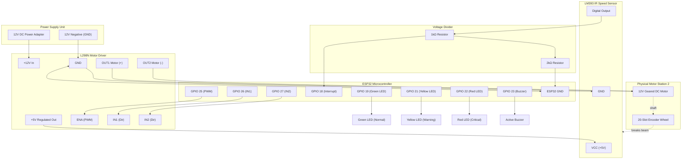

# Hardware Integration & Wiring Specification
## FactoryPulse AI — ESP32 Physical Workstation Station 2

This document provides complete, beginner-friendly instructions for assembling, wiring, calibrating, and safely operating the physical workstation for **Station 2 (Drilling/Machining)**.

---

### 1. Bill of Materials (BOM)

| Component | Specification | Quantity | Primary Purpose |
| :--- | :--- | :---: | :--- |
| **ESP32 DevKit V1** | 30-pin or 38-pin, 2.4GHz Wi-Fi + BLE | 1 | Microcontroller, MQTT node, edge telemetry |
| **DC Geared Motor** | 12V DC, 300–2000 RPM nominal, geared | 1 | Physical workstation representation |
| **L298N Motor Driver** | Dual H-Bridge, 5V–35V, 2A peak per channel | 1 | Bidirectional PWM speed control |
| **IR Optical Speed Sensor** | LM393 comparator module, slot optocoupler | 1 | Motor rotation pulse measurement |
| **Optical Encoder Disc** | 20-slot slotted disk (fits motor shaft) | 1 | Provides optical interruptions for RPM |
| **Regulated Power Supply** | 12V DC, 2A minimum | 1 | Power source for motor and L298N |
| **Active Buzzer** | 3.3V or 5V active buzzer module | 1 | Audible alert alarm |
| **LEDs (5mm)** | Green, Yellow, Red | 1 each | Visual machine status indicator |
| **Resistors** | 220Ω (x3 for LEDs), 1kΩ & 2kΩ (voltage divider) | 5 | Current limiting & level shifting |
| **NPN Transistor** | 2N2222 or BC547 (optional for buzzer) | 1 | Buzzer driver (if not using 3.3V module) |
| **Breadboard & Wires** | Half-size breadboard + Dupont jumper wires | 1 set | Circuit prototyping |

---

### 2. Critical Safety & Voltage Precautions

> [!CAUTION]
> **12V High Voltage Warning:** Never connect 12V DC power directly to any ESP32 pin. The ESP32 operates exclusively at **3.3V**. Applying 5V or 12V to a 3.3V GPIO will permanently destroy the microcontroller chip.

1. **Common Ground is Mandatory:** The **GND** of the 12V power supply, the **GND** of the L298N driver, the **GND** of the ESP32, and the **GND** of all sensors MUST be connected together. Without a shared common reference ground, PWM control will glitch and IR pulse counts will be invalid.
2. **L298N 5V Regulator Jumper:**
   - When powering L298N with 12V, keep the **onboard 5V regulator jumper attached**.
   - The L298N's "+5V" terminal then outputs a regulated 5V rail. This rail can power the IR speed sensor module and active buzzer.
   - **Do not connect this 5V to the ESP32 3.3V pin.** You may connect it to the ESP32 `VIN` pin (if powered from external 5V), or power the ESP32 via standard USB cable.
3. **IR Sensor Output Voltage Division:**
   - Most LM393 IR speed sensor modules are powered with 5V and produce 5V digital logic on their `DO` pin.
   - ESP32 GPIO pins are rated for **3.3V max**.
   - Use a simple two-resistor voltage divider to step down the sensor output:
     ```text
     Sensor DO (5V) ────[ 1kΩ Resistor ]────┬──── ESP32 GPIO 18 (3.3V Signal)
                                            │
                                      [ 2kΩ Resistor ]
                                            │
                                           GND
     ```
   - Voltage calculation: $V_{out} = 5.0\text{V} \times \frac{2000}{1000 + 2000} = 3.33\text{V}$.

---

### 3. Pin-to-Pin Master Wiring Table

| Peripheral | Peripheral Pin | Connected to ESP32 Pin | Logic Level | Notes |
| :--- | :--- | :--- | :--- | :--- |
| **L298N Driver** | ENA (Enable A) | **GPIO 25** | 3.3V PWM | Speed control via ESP32 LEDC channel 0 |
| **L298N Driver** | IN1 (Direction) | **GPIO 26** | 3.3V Digital Out | Forward direction control |
| **L298N Driver** | IN2 (Direction) | **GPIO 27** | 3.3V Digital Out | Reverse direction control |
| **L298N Driver** | GND | **GND** | 0V Reference | Common Ground with 12V Supply |
| **L298N Driver** | +12V Terminal | **12V Adapter (+) Positive** | +12V DC | Dedicated motor power rail |
| **IR Speed Sensor**| VCC | **5V Rail (L298N or USB)** | +5V DC | Power supply for infrared LED |
| **IR Speed Sensor**| GND | **GND** | 0V | Common Ground |
| **IR Speed Sensor**| DO (Digital Out) | **GPIO 18** (via divider) | 3.3V Digital In | Hardware interrupt (FALLING edge) |
| **Status LED Green**| Anode (+) via 220Ω | **GPIO 19** | 3.3V Digital Out | Normal machine operation |
| **Status LED Yellow**| Anode (+) via 220Ω | **GPIO 21** | 3.3V Digital Out | Warning / Developing bottleneck |
| **Status LED Red** | Anode (+) via 220Ω | **GPIO 22** | 3.3V Digital Out | Critical alarm / Stoppage |
| **All LED Cathodes**| Cathode (-) | **GND** | 0V | Common Ground |
| **Active Buzzer** | Signal / VCC | **GPIO 23** | 3.3V Digital Out | Audible warning sounder |
| **Active Buzzer** | GND | **GND** | 0V | Common Ground |

---

### 4. Circuit Schematic Diagram



---

### 5. IR Pulse Calibration & Calibration Equation

The optical encoder disc features 20 radial slots. Every full revolution interrupts the infrared beam 20 times.

$$\text{RPM} = \frac{\text{Pulses Counted} \times 60}{\text{Pulses Per Revolution} \times \Delta t_{\text{seconds}}}$$

For a 1.0-second sampling window ($\Delta t = 1.0\text{s}$) with $N = 20$ slots:

$$\text{RPM} = \frac{\text{Pulses} \times 60}{20 \times 1.0} = \text{Pulses} \times 3.0$$

#### Hybrid Mode Throughput Relationship
When operating in Hybrid Hardware Mode, the physical motor's measured RPM directly governs the processing rate of Station 2 inside the software simulator:

$$\text{Station 2 Throughput (parts/min)} = \text{Nominal Capacity} \times \left( \frac{\text{Measured RPM}}{\text{Base RPM}} \right) = 15.0 \times \left( \frac{\text{Measured RPM}}{1500} \right)$$

- When motor runs at **1500 RPM**: Throughput = 15.0 parts/min (Balanced line, zero accumulation).
- When motor slows to **750 RPM**: Throughput = 7.5 parts/min (Input rate 15.0 > Output rate 7.5 $\implies$ Station 2 queue increases by 7.5 units/min).
- When motor stops (**0 RPM**): Throughput = 0.0 parts/min (Immediate queue accumulation and critical alarm).

---

### 6. Verification and Troubleshooting Steps

1. **Verify Pulse Counting in Serial Monitor:**
   - Open PlatformIO Serial Monitor at **115200 baud**.
   - Manually turn the motor shaft by hand. Observe pulse increments and non-zero RPM.
2. **Verify Motor Speed Control:**
   - Send MQTT command to `factory/devices/motor01/commands`:
     ```json
     {"action": "SET_SPEED", "speed_pwm": 150}
     ```
   - Observe motor speed change and corresponding telemetry update.
3. **Verify Alert Feedback:**
   - Send MQTT alert to `factory/alerts`:
     ```json
     {"severity": "CRITICAL", "message": "Emergency Stop Triggered"}
     ```
   - Confirm that the **Red LED** illuminates and the **Buzzer** emits a 500ms warning pulse.

